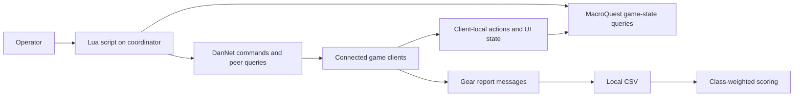

# Architecture and trade-offs

## Client coordination

The scripts depend on MacroQuest's `mq` module and Top Level Objects to inspect character, inventory, target, and UI state. DanNet carries commands and queries between game clients. This is a distributed scripting setup, not a distributed transaction system: sending a command does not establish that every client completed it.

## Three useful code paths

### Formation: sequence a multi-client workflow

`raidinvite.lua` breaks setup into disbanding, group formation, and raid formation. `splitraid.lua` applies a similar sequence to two rosters. The public roster uses fictional names consistently across files.

Current limitation: fixed waits and completion messages are not full success verification. A stronger version would check observed group membership, retry individual failures, and make each phase safe to repeat.

### Encounter control: react to changing state

`empadd.lua` classifies encounter adds into search, pull, drag, and fight states. Pulling takes precedence when aggro is lost. Movement and threat actions depend on the observed target state rather than a single fixed command sequence.

Current limitation: encounter identifiers, positions, timing, and character assignments are configured for a particular scenario. The fictional names must be replaced before execution. Changes to a server or client can invalidate assumptions.

### Inventory distribution: query, calculate, act

`PotionDistribute.lua` discovers peers, queries inventory, calculates a top-off quantity, and drives quantity and trade windows. It skips peers already at the target and includes several failure branches.

Current limitation: a missing inventory response currently falls back to zero. Trade-window closure is not a complete verification of the recipient's final inventory. A more robust version would distinguish unknown state from an empty inventory and reconcile counts after each trade.

## Reporting

`gearlog.lua` collects item and focus data into a local CSV. `score.lua` applies the weights in `lib/weights.lua`. The scoring rules are game-specific heuristics. The CSV reader is simple and is not a general quoted-CSV parser. Collection uses a time window rather than a per-client acknowledgement ledger.

Optional Discord posting reads its endpoint from a local environment variable. It invokes the local `curl` command and does not provide robust HTTP-response validation; a delivery-attempt message is not proof of receipt. No endpoint or credential is shipped in this repository.

## Verification scope

Publication checks cover Lua syntax, local module references, fictional roster consistency, and scanning the selected snapshot for private identifiers and credential patterns. They do not establish compatibility with a live MacroQuest installation, server, plugin set, or game client. No game actions or external messages were executed during preparation of this public copy.
